# Project overview

This report answers the four questions of Project 2. Every answer comes with working code that was run on the datasets provided or on data scraped for this project. The full project, including the datasets, the Java MapReduce project, the R Markdown notebooks and their rendered HTML output, is in the private GitHub repository **https://github.com/HappyDevs1/map-reduce-web-scraper**.

| Question | Folder | Main files |
|---|---|---|
| 1. Hadoop MapReduce keyword search | `q1-mapreduce/` | Java source, Hadoop config, run scripts, `evidence/` |
| 2. LDA topic modelling | `q2-lda/` | `q2_lda_topic_modelling.Rmd` and `.html` |
| 3. WebText API proof of concept | `q3-webtext/` | `q3_webtext_mining.Rmd` and `.html` |
| 4. ETL with R and PostgreSQL | `q4-etl/` | `q4_etl_books.Rmd` and `.html`, `sql/` |
| Datasets | `data/` | `raw/`, `extracted/`, `processed/` |

Tools used: Java 17, Apache Hadoop 3.5.0 (HDFS and YARN on a single node), Maven, R 4.6 with tidytext, topicmodels, textrank, lexRankr, rvest and RPostgres, and PostgreSQL 17.

# Question 1: Hadoop MapReduce keyword search

## 1.1 Logical layout of the keyword search

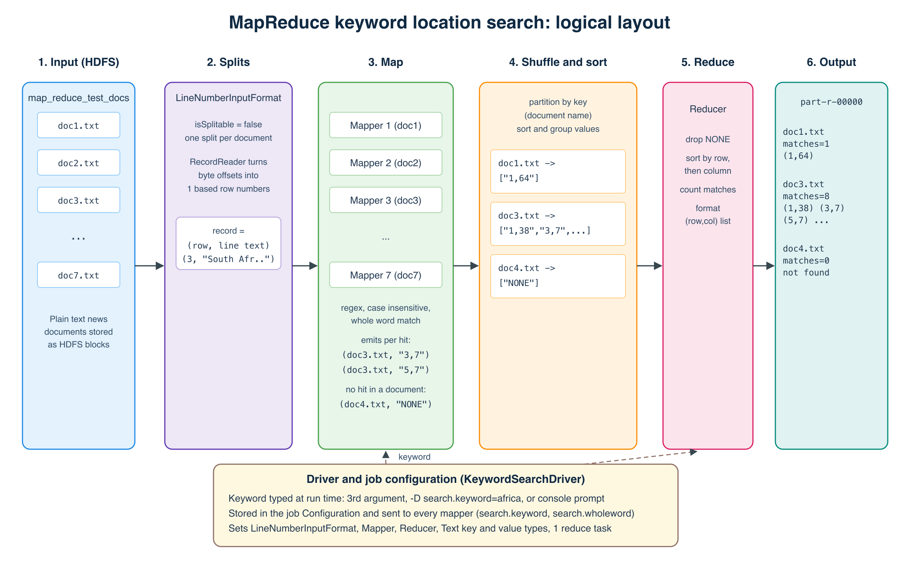

The goal is to return the row and column of every occurrence of a keyword in every document. The keyword is not fixed in the code, and matching ignores case. The job runs in six logical stages.

1. **Input.** The seven documents from `map_reduce_test_docs.zip` are copied into HDFS (`/user/<user>/keyword-search/input`). HDFS stores them as blocks spread across DataNodes.
2. **Input splits and record reading.** Hadoop's default `TextInputFormat` hands the mapper a byte offset, which is not a row number. Rows can only be counted correctly if one reader sees a document from its first line. A custom `LineNumberInputFormat` therefore marks files as not splittable, so each document becomes one split. Its record reader wraps Hadoop's `LineRecordReader` and replaces the byte offset with a running line counter. Every record becomes `(rowNumber, lineText)`. Lines are still streamed one at a time, so memory use stays flat for large documents.
3. **Map.** One mapper runs per document, in parallel across the cluster. In `setup()` it reads the keyword from the job configuration and compiles a case insensitive, whole word regular expression. For each line it finds every match and emits `(documentName, "row,column")`, where the column is the 1 based character position where the match starts. If a document has no match at all, the mapper emits `(documentName, "NONE")` in `cleanup()` so that the result also lists documents where the word was not found. Hadoop counters record lines scanned, matches and documents with a match.
4. **Shuffle and sort.** The framework partitions the map output by key (the document name), sends each key to a reducer, and groups all of a document's locations together.
5. **Reduce.** The reducer receives `(documentName, [locations])`, drops the `NONE` marker, sorts the locations by row and then by column, counts them and formats one output line per document.
6. **Output.** With one reduce task the result is a single file, `part-r-00000`, for example `doc3.txt  keyword=africa  matches=8  locations=(1,38) (3,7) (5,7) ...`.

The **driver** ties it together. It reads the keyword from the third command line argument, a `-D search.keyword=` option, or a console prompt, puts it in the job `Configuration` (which Hadoop ships to every task), and wires up the input format, mapper, reducer and key and value types.

## 1.2 Mapper implementation

The mapper relies on two helper classes: the input format that supplies row numbers, and a small matcher class that does the case insensitive search. Keeping the matching logic in its own class means it can be unit tested without Hadoop (`KeywordMatcherTest`, 4 tests passing).

**LineNumberInputFormat.java** gives the mapper `(row, line)` instead of `(byteOffset, line)`:

{{file:q1-mapreduce/src/main/java/za/itbda/keywordsearch/LineNumberInputFormat.java}}

**KeywordMatcher.java** finds every case insensitive match on a line and returns the starting columns. The look behind and look ahead make it a whole word match, so `africa` matches "Africa" and "AFRICA" but not "African". Setting `search.wholeword=false` switches to partial matching.

{{file:q1-mapreduce/src/main/java/za/itbda/keywordsearch/KeywordMatcher.java}}

**KeywordSearchMapper.java**:

{{file:q1-mapreduce/src/main/java/za/itbda/keywordsearch/KeywordSearchMapper.java}}

### Demonstration evidence

The job was run in two ways. First in Hadoop local mode, with the keyword typed in at the prompt to show it is not hardcoded:

```
$ ./run_local.sh
Enter the keyword to search for: africa
Searching for keyword: africa (whole word = true, case insensitive)
...
Job job_local357785875_0001 completed successfully
    KEYWORD_MATCHES=16   DOCUMENTS_WITH_MATCH=4   LINES_SCANNED=307
```

Then on a single node cluster with HDFS and YARN (`./run_cluster.sh africa`). YARN launched 7 map tasks (one per document) and 1 reduce task:

```
INFO mapreduce.Job: Running job: job_1794505191986_0001
INFO mapreduce.Job:  map 100% reduce 0%
INFO mapreduce.Job:  map 100% reduce 100%
INFO mapreduce.Job: Job job_1794505191986_0001 completed successfully
        Launched map tasks=7
        DOCUMENTS_WITH_MATCH=4
        KEYWORD_MATCHES=16
        LINES_SCANNED=307
```

Result read back from HDFS (`hdfs dfs -cat .../output/part-r-00000`):

{{file:q1-mapreduce/evidence/result_cluster_africa.txt}}

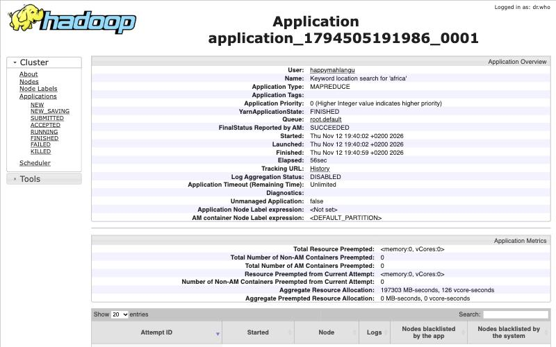

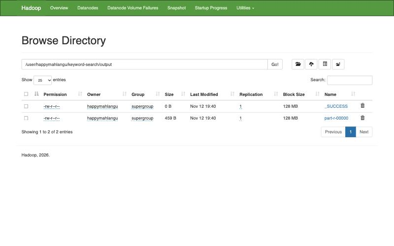

To check the result independently, a separate Python script scanned the same files with the same rule. It found exactly the same 16 positions. Running with `-D search.keyword=AFRICA -D search.wholeword=false` (upper case input, partial matching) returned 22 matches, because words such as "African" are then counted too. That confirms case insensitivity and the switch both work. The full logs are in `q1-mapreduce/evidence/`.

## 1.3 Reducer implementation

{{file:q1-mapreduce/src/main/java/za/itbda/keywordsearch/KeywordSearchReducer.java}}

The reducer is called once per document. Hadoop has already grouped every `"row,column"` value for that document during the shuffle. The reducer parses them, ignores the `NONE` marker, sorts them so they read top to bottom like the original text, and writes the keyword, the number of matches and the ordered `(row,col)` list. A document whose only value was `NONE` is reported as `matches=0  locations=not found`.

## 1.4 Hadoop MapReduce configuration

Configuration happens at two levels: the job configuration in the driver, and the cluster configuration in the Hadoop XML files.

**Job configuration (KeywordSearchDriver.java):**

{{file:q1-mapreduce/src/main/java/za/itbda/keywordsearch/KeywordSearchDriver.java}}

**Cluster configuration** (`q1-mapreduce/hadoop-config/`, used through `HADOOP_CONF_DIR`):

| File | Setting | Value | Purpose |
|---|---|---|---|
| core-site.xml | `fs.defaultFS` | `hdfs://localhost:9000` | Address of the HDFS NameNode |
| core-site.xml | `hadoop.tmp.dir` | `/tmp/hadoop-${user.name}` | Base folder for Hadoop data |
| hdfs-site.xml | `dfs.replication` | `1` | One copy of each block on a single node |
| hdfs-site.xml | `dfs.blocksize` | `134217728` | 128 MB HDFS blocks |
| mapred-site.xml | `mapreduce.framework.name` | `yarn` | Run MapReduce jobs on YARN |
| mapred-site.xml | `mapreduce.map.memory.mb`, `mapreduce.reduce.memory.mb` | `1024` | Container size for each task |
| mapred-site.xml | `mapreduce.job.reduces` | `1` | Single sorted result file |
| yarn-site.xml | `yarn.resourcemanager.hostname` | `localhost` | Where jobs are submitted |
| yarn-site.xml | `yarn.nodemanager.aux-services` | `mapreduce_shuffle` | Shuffle service reducers pull map output from |
| yarn-site.xml | `yarn.nodemanager.resource.memory-mb` | `4096` | Memory YARN can hand out on this node |

{{file:q1-mapreduce/hadoop-config/mapred-site.xml}}

{{file:q1-mapreduce/hadoop-config/yarn-site.xml}}

The run script starts the daemons with `hdfs --daemon start namenode`, `hdfs --daemon start datanode`, `yarn --daemon start resourcemanager` and `yarn --daemon start nodemanager`, so no SSH setup is needed. It then uploads the input with `hdfs dfs -put` and submits the job with `hadoop jar target/keyword-search.jar <input> <output> [keyword]`.

# Question 2: Topic modelling with LDA

The full notebook with all code and output is `q2-lda/q2_lda_topic_modelling.Rmd` (rendered as `.html`). The number of topics and the number of words per topic are notebook parameters (`n_topics = 4`, `top_k = 10`), so they can be changed without touching the code.

## 2.1 Data frame and denoising

Every file in `news.zip` becomes one row of a data frame with two columns, `file_name` and `content`:

{{chunk:q2-lda/q2_lda_topic_modelling.Rmd:load}}

The ten articles are South African government news items from July 2024. Profiling the raw text showed the noise to remove: every file starts with a dateline (for example "Tuesday, July 9, 2024"), there are curly quotes and other non ASCII characters, money amounts such as "R30 000", and blank or padded lines. The cleaning pipeline:

| Step | Technique | Why |
|---|---|---|
| 1 | Normalise non breaking spaces, curly quotes and dashes | The same word should not appear in several encodings |
| 2 | Remove the dateline | Dates repeat in every file and say nothing about the topic |
| 3 | Lower case, and join "South Africa" into one token | "Eskom" and "eskom" become one term, and the country name is not split |
| 4 | Remove URLs, numbers, currency amounts and punctuation | They add sparse, meaningless terms |
| 5 | Remove English and SMART stop words plus news filler (said, says, also, will, month names) | These words appear everywhere and hide the topic words |
| 6 | Lemmatise | "governments" and "government" become the same term |
| 7 | Drop tokens shorter than 3 letters | Removes leftovers from possessives |

{{chunk:q2-lda/q2_lda_topic_modelling.Rmd:clean}}

Cleaning removed roughly half of every article (between 46% and 54% of the words), leaving 875 distinct terms across the 10 documents. The cleaned data frame is saved as `data/processed/news_clean.csv`.

## 2.2 LDA topics and word distributions

A document term matrix was built from the cleaned tokens. To choose the number of topics, models with 2 to 8 topics were compared on perplexity. Perplexity always falls as more topics are added, so the elbow of the curve was used: the big gains stop at k = 4.

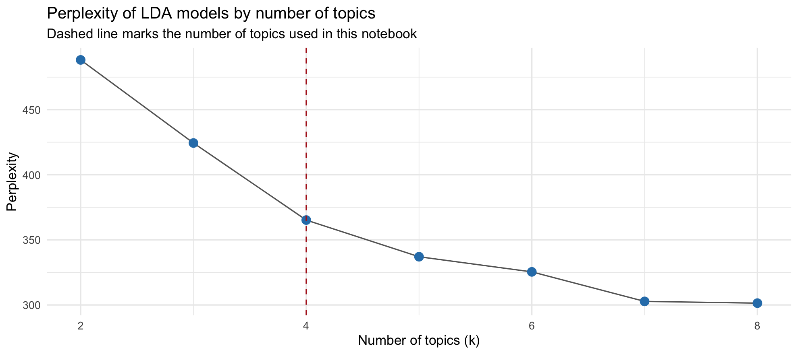

The model was fitted with Gibbs sampling (2,000 iterations, alpha = 0.1, fixed seed for repeatable results):

{{chunk:q2-lda/q2_lda_topic_modelling.Rmd:lda}}

**Top topics ranked by prevalence** (average share across all documents):

| Rank | Topic | Prevalence | Theme |
|---|---|---|---|
| 1 | 4 | 0.313 | Service delivery and financial accountability |
| 2 | 3 | 0.287 | Public safety and weather alerts |
| 3 | 2 | 0.216 | Education and labour priorities |
| 4 | 1 | 0.184 | Coalition government and public administration |

**Top 10 words per topic with their probability (beta):**

| Rank | Topic 1 | Topic 2 | Topic 3 | Topic 4 |
|---|---|---|---|---|
| 1 | government (0.042) | department (0.037) | police (0.022) | service (0.033) |
| 2 | public (0.033) | priority (0.018) | cape (0.016) | invoice (0.030) |
| 3 | coalition (0.030) | school (0.014) | cold (0.016) | department (0.021) |
| 4 | administration (0.021) | unemployment (0.014) | expect (0.014) | pay (0.021) |
| 5 | country (0.019) | continue (0.012) | weather (0.014) | eskom (0.020) |
| 6 | minister (0.014) | meth (0.012) | west (0.014) | day (0.020) |
| 7 | role (0.014) | ensure (0.011) | western (0.014) | psc (0.020) |
| 8 | governance (0.011) | report (0.011) | team (0.012) | gxoyiya (0.016) |
| 9 | policy (0.011) | labour (0.011) | sandf (0.012) | provider (0.015) |
| 10 | relationship (0.011) | work (0.009) | week (0.010) | official (0.013) |
| Top 10 share | 0.204 | 0.148 | 0.142 | 0.209 |

**Topic distribution per document (gamma):**

| Document | T1 | T2 | T3 | T4 | Dominant | Headline |
|---|---|---|---|---|---|---|
| news_7 | 0.630 | 0.070 | 0.001 | 0.300 | 1 | Democratic dispensation necessitated a complete overhaul of state bureaucracy |
| news_8 | 0.917 | 0.083 | 0.000 | 0.000 | 1 | Trust and relationships key ingredients to coalition governments |
| news_2 | 0.001 | 0.998 | 0.001 | 0.001 | 2 | Gauteng Education commits to implementing Mayibuye Primary School remedial actions |
| news_3 | 0.171 | 0.828 | 0.000 | 0.000 | 2 | New Labour Minister charts the way forward |
| news_10 | 0.000 | 0.092 | 0.829 | 0.079 | 3 | Wet, cold weather expected to continue in Western Cape |
| news_4 | 0.001 | 0.001 | 0.988 | 0.010 | 3 | Police recue two kidnapped victims in Benoni |
| news_5 | 0.001 | 0.048 | 0.950 | 0.001 | 3 | President Ramaphosa sends condolences to deceased SANDF members |
| news_1 | 0.001 | 0.034 | 0.101 | 0.863 | 4 | Eskom former official, service provider appear in court |
| news_6 | 0.000 | 0.000 | 0.000 | 0.999 | 4 | Accounting officers must be accountable for non-payment of service providers |
| news_9 | 0.118 | 0.001 | 0.001 | 0.881 | 4 | PSC applauds officials who refuse to accept a bribes |

**Interpretation.** Nine of the ten articles belong mostly to one topic (gamma above 0.8), so the four topics separate the news well. Topic 4 is the most prevalent and groups the three stories about how public money is handled: the Eskom fraud case, late payment of suppliers and the Public Service Commission on bribes. Topic 3 brings together safety and emergency stories (police, SANDF, Western Cape weather). Topic 2 covers education and labour, and Topic 1 covers coalition government and the public service. The clearest mixed article is news_7, which is 63% Topic 1 and 30% Topic 4 because it discusses bureaucracy reform and accountability together. The beta values are small (the strongest words sit between 0.02 and 0.04) because 875 terms are shared among only 10 short documents, so the ranking of words matters more than their size.

## 2.3 Visualising the top words per topic

Three methods were used.

**Method 1: faceted bar chart** of the top 10 words and their beta per topic. It shows the exact weights and makes the ranking easy to read.

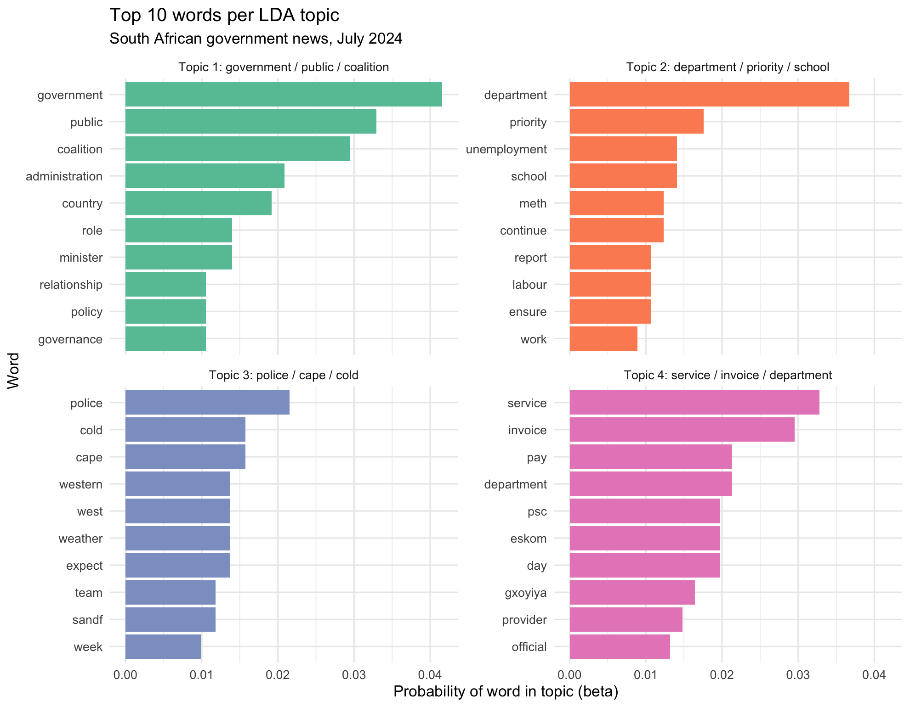

**Method 2: word clouds** of the top 30 words per topic, with word size proportional to beta. They give a quick sense of each theme at a glance.

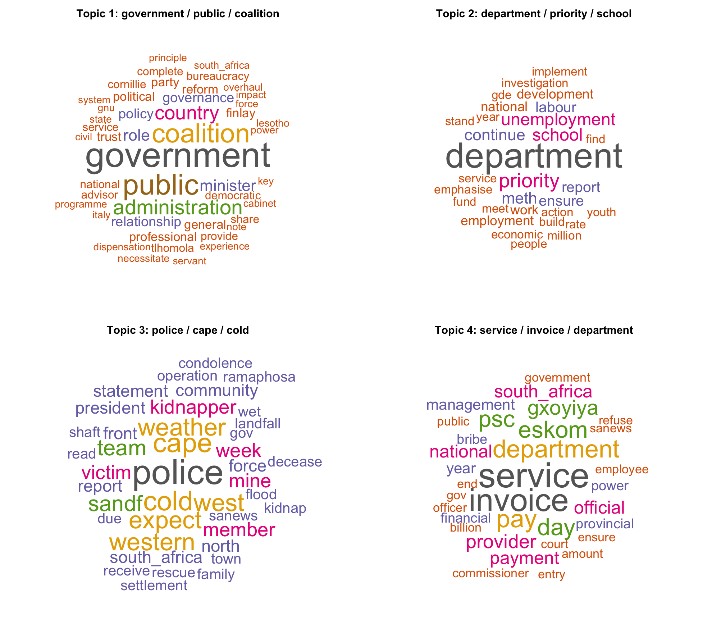

**Method 3: heat map** of every top word against every topic. It shows that the topics overlap very little. The clearest shared word is "department", which is strong in both Topic 2 (education department) and Topic 4 (departments paying invoices), while "government", "public" and "service" have small weights outside their main topic.

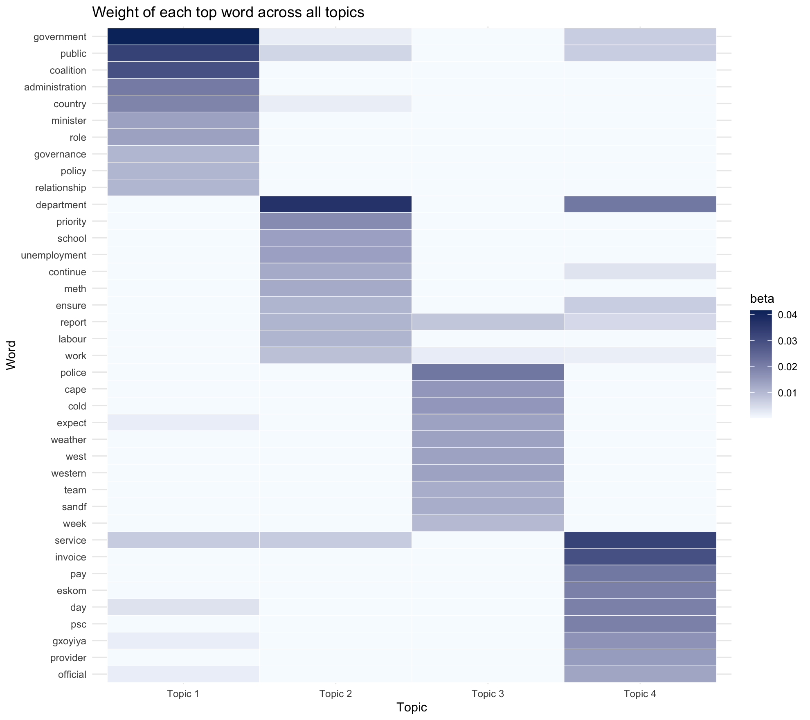

The document to topic heat map confirms the gamma table above.

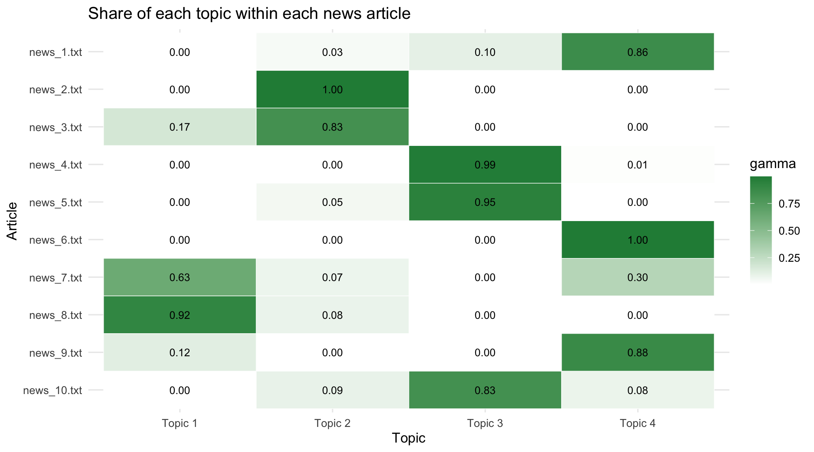

# Question 3: WebText API proof of concept

The notebook is `q3-webtext/q3_webtext_mining.Rmd`. Its only input is a web link (`params$url`). The page chosen is the Wikipedia article **Climate change in Africa** (https://en.wikipedia.org/wiki/Climate_change_in_Africa), which fits the brief's theme of language as environmental data. At the end of the notebook the whole pipeline is wrapped in one function, `webtext_api(url)`, which is the shape a real API endpoint would take.

## 3.1 Extracting clean web text into an R data structure

**Fair use of web scraping.** Before scraping, the code checks `robots.txt` and stops if the path is not allowed. Only one page is requested, with a clear user agent and a delay, and the HTML is cached in `data/raw/` so knitting the notebook again does not hit the site. Wikipedia text is licensed CC BY-SA 4.0, which allows reuse with attribution, and the licence and source URL are stored with the data. No personal data is collected.

{{chunk:q3-webtext/q3_webtext_mining.Rmd:fair_use}}

{{chunk:q3-webtext/q3_webtext_mining.Rmd:fetch}}

Headings and paragraphs are read in page order so that every paragraph keeps its section. Infoboxes, tables, captions and navigation are left out because only `h2`, `h3` and `p` nodes are selected.

{{chunk:q3-webtext/q3_webtext_mining.Rmd:extract}}

The result is a named list. `meta` holds the URL, title, last edit date, retrieval time and licence. `paragraphs` is a data frame with 101 rows (`para_id`, `section`, `subsection`, `raw_text`) spread across 8 sections, with Adaptation (39 paragraphs), Socioeconomic impacts (17) and Impacts by region (17) the largest.

## 3.2 Preprocessing

Profiling the raw paragraphs found 266 Wikipedia citation markers such as `[96]`, 53 non ASCII characters (curly quotes, en dashes, degree signs) and one empty paragraph. Cleaning is done in two layers. Sentences stay readable, because extractive summaries reuse real sentences. Words are reduced to lemmas for counting.

| Step | Technique | Purpose |
|---|---|---|
| 1 | Drop non content sections (See also, References, External links) | Removes link lists and bibliography |
| 2 | Strip citation markers such as [12], [a] and [citation needed] | Footnotes are not part of the prose |
| 3 | Normalise quotes, dashes and non breaking spaces, collapse whitespace | One consistent character set |
| 4 | Remove very short paragraphs and duplicates | Captions and stubs add little |
| 5 | Split into sentences, drop fragments under 6 words | Units for summarisation |
| 6 | Lower case, remove numbers, punctuation and stop words, plus title words (climate, change, africa) | Keeps meaningful content words |
| 7 | Lemmatise | "droughts" and "drought" count once |

{{chunk:q3-webtext/q3_webtext_mining.Rmd:clean_paragraphs}}

| Stage | Count |
|---|---|
| Raw paragraphs | 101 |
| Clean paragraphs | 100 |
| Sentences | 322 |
| Content words (lemmas) | 3,843 |
| Unique lemmas | 1,231 |

Example before and after: "...a general decrease in March – May (MAM) seasonal rains with a slight increase during June – September (JJAS) and October – December (OND) rains,[96] although there appears to have been a recent recovery in the MAM rains.[97]" becomes "...a general decrease in March to May (MAM) seasonal rains with a slight increase during June to September (JJAS) and October to December (OND) rains, although there appears to have been a recent recovery in the MAM rains."

## 3.3 Text summarisation

Three summarisation techniques were applied, each reducing the 322 sentences to 6.

### Technique 1: word frequency scoring (Luhn method)

Each sentence is scored by the normalised frequency of its content words, divided by the square root of its length so that long sentences are not automatically favoured.

{{chunk:q3-webtext/q3_webtext_mining.Rmd:freq_summary}}

Summary: (1) The impacts include higher temperatures, droughts, changing rainfall patterns, and increased climate variability. (2) Others refer to this as a period of "hydrological intensification" with much of the annual rainfall increase coming from more severe rain events and sometimes flooding... (3) The World Health Organization's report "Adaptation to Climate Change in Africa Plan of Action for the Health Sector 2012 to 2016" is intended to "provide a comprehensive and evidence-based coordinated response..." (4) Key adaptations in northern Africa relate to increased risk of water scarcity... (5) In Eastern Africa adaptation options are varied, including improving use of climate information, actions in the agriculture and livestock sector, and in the water sector. (6) South Africa has adopted in August 2020 its National Climate Change Adaptation Strategy...

### Technique 2: TextRank

Sentences are nodes in a graph, linked by how many lemmas they share. PageRank picks the sentences most connected to the rest of the article.

{{chunk:q3-webtext/q3_webtext_mining.Rmd:textrank}}

Summary: (1) It is estimated that by 2030, the people of Africa will be exposed to a rise in sea level due to an increase in temperature. (2) The impacts include higher temperatures, droughts, changing rainfall patterns, and increased climate variability. (3) The agriculture sector is sensitive to climate variability, especially the inter-annual variability of precipitation, temperature patterns, and extreme weather events (droughts and floods). (4) Climate change in Kenya is expected to have large impacts on the agricultural sector, which is predominantly rain-fed... (5) Reduced water availability, in turn, interacts with increasing temperatures to create need for adaptation among rainfed wheat production and changing disease risk... (6) In Eastern Africa adaptation options are varied...

### Technique 3: LexRank

Also graph based, but sentences are compared with TF-IDF weighted cosine similarity, so shared rare words count for more than shared common words.

{{chunk:q3-webtext/q3_webtext_mining.Rmd:lexrank}}

Summary: (1) Climate change in Africa is a serious threat because the continent is one of the most vulnerable regions to the effects of climate change, despite being responsible for less than 4% of global greenhouse gas emissions. (2) The impacts include higher temperatures, droughts, changing rainfall patterns, and increased climate variability. (3) Africa will be one of the regions most impacted by the adverse effects of climate change. (4) The impacts of climate change on agricultural production in Africa will have serious implications for food security and livelihoods. (5) Climate change will significantly affect agriculture in West Africa by increasing the variability in food production, access and availability. (6) In the future, both rainfall and temperature are projected to change over Eastern Africa.

### Comparing the methods

| Method | Sentences | Words kept | Compression | Sections covered |
|---|---|---|---|---|
| Frequency | 6 | 222 | 2.8% | 3 |
| TextRank | 6 | 145 | 1.8% | 3 |
| LexRank | 6 | 117 | 1.5% | 3 |

The Jaccard overlap between the chosen sentences is low (0.20 between Frequency and TextRank, 0.09 for both pairs involving LexRank). All three agree on only sentence 65, "The impacts include higher temperatures, droughts, changing rainfall patterns, and increased climate variability", which is therefore the best single line summary of the page. Because each six sentence summary only touches three of the eight sections, a structured summary was also built from the highest TextRank sentence in each section:

| Section | Key sentence |
|---|---|
| Introduction | Climate change is causing increasingly erratic rainfall patterns, more frequent extreme weather events such as droughts and floods, and rising sea-surface temperatures across the continent. |
| Greenhouse gas emissions | Africa's per person greenhouse gas emissions are low compared to other continents. |
| Impacts | It is estimated that by 2030, the people of Africa will be exposed to a rise in sea level due to an increase in temperature. |
| Socioeconomic impacts | The impacts include higher temperatures, droughts, changing rainfall patterns, and increased climate variability. |
| Water scarcity | Climate change, and resulting in increased temperatures, storms, droughts, and rising sea levels, will affect the incidence and distribution of infectious disease across the globe. |
| Impacts by region | The global mean temperature in this region is to increase by 1.5 °C to 2 °C. |
| Adaptation | In Eastern Africa adaptation options are varied, including improving use of climate information, actions in the agriculture and livestock sector, and in the water sector. |
| Society and culture | This pattern of parachute science... prevents local researchers from doing groundbreaking work, because they do not have the funding... |

### Visualisations

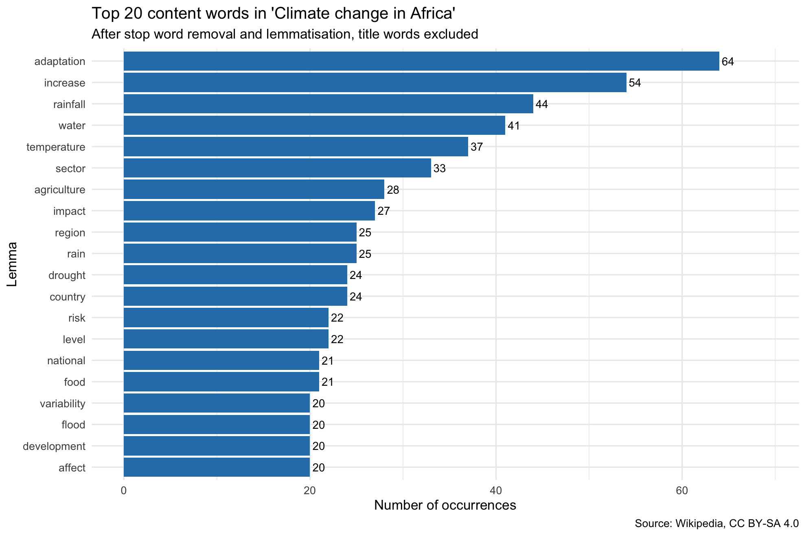

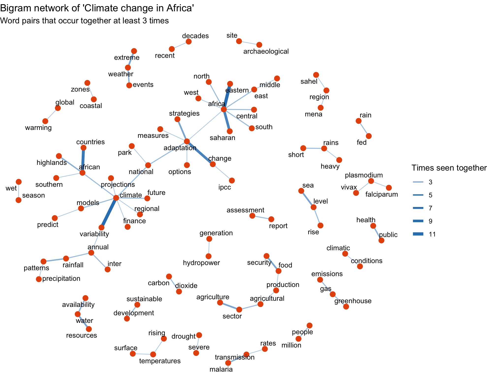

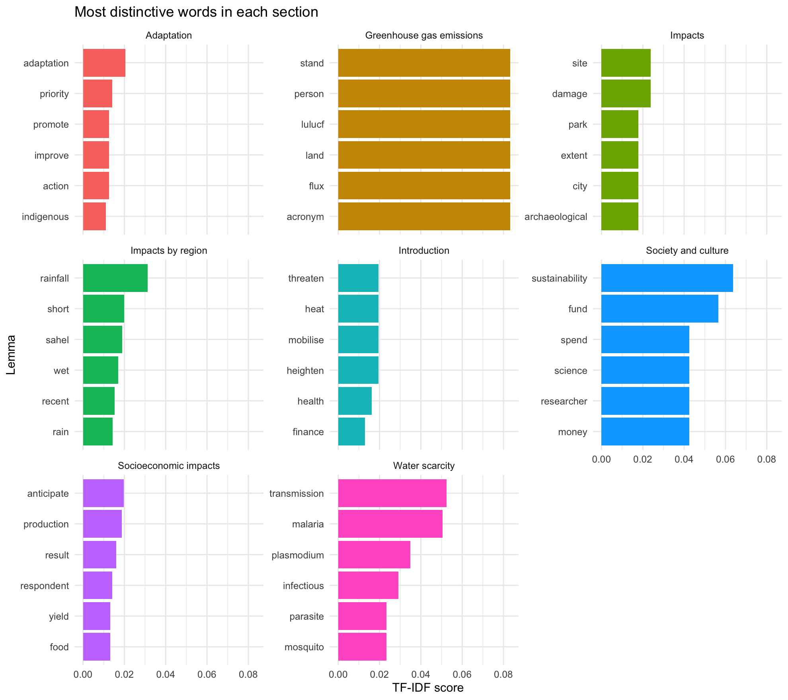

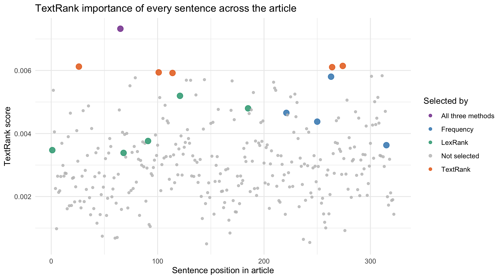

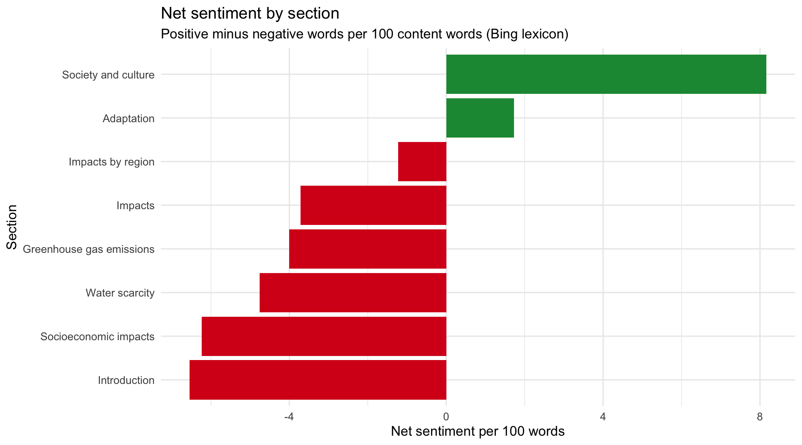

The code for all five charts is in the notebook. As an example, the bigram network:

{{chunk:q3-webtext/q3_webtext_mining.Rmd:viz_bigram}}

### Findings

**What the article is about.** With the title words removed, the most frequent lemmas are *adaptation* (64), *increase* (54), *rainfall* (44), *water* (41) and *temperature* (37). The article is less about the science of warming and more about how a hotter, less predictable climate reaches people through water and rain, and how Africa responds. *Agriculture*, *drought*, *food* and *flood* in the top 20 show that farming and food supply are the main channel of harm.

**Main idea clusters.** The bigram network splits into a weather cluster (*extreme weather events*, *rainfall patterns*, *sea level rise*), a farming cluster (*agriculture sector*, *food security*, *rain fed*), a health cluster (*malaria transmission*, *plasmodium falciparum*, *public health*), a policy cluster (*national adaptation*, *adaptation strategies*, *climate finance*) and a regional cluster (*eastern*, *saharan*, *north*, *central africa*). Together they work as a table of contents built from the language alone.

**What each section adds.** TF-IDF shows the sections are well separated. *Water scarcity* is really about disease (*malaria*, *plasmodium*, *mosquito*, *parasite*), which the heading does not suggest. *Impacts by region* is about rainfall seasons in the *Sahel*, and *Society and culture* is about who funds and does the research.

**How the summaries differ.** The frequency method favours long sentences full of common terms and picked four policy sentences from Adaptation, so it reads like a list of programmes. TextRank favours short, general sentences that share words with many others, and centres on agriculture and rainfall. LexRank picked the opening sentence, which says Africa is among the most vulnerable regions while producing under 4% of global emissions, because it combines rare and central ideas. The position chart shows high scoring sentences spread across the whole article, so a summary that just takes the first few sentences would miss a lot. The section by section digest is the most complete summary for a reader.

**Tone.** Sentiment is negative where the article describes the problem (Introduction -6.5 and Socioeconomic impacts -6.2 net words per 100) and positive where it describes responses (Adaptation +1.7, Society and culture +8.2). The article follows a problem then response structure. The most common negative words are *risk*, *drought* and *vulnerable*.

**Limitations.** The summaries are extractive, so they can only reuse sentences already on the page. The Bing lexicon is general purpose and treats words like *well* and *like* as positive even when they are not used that way.

# Question 4: ETL with R and PostgreSQL

The notebook is `q4-etl/q4_etl_books.Rmd`. The SQL lives in `q4-etl/sql/`.

## 4.1 Use case and scraping

**Use case.** A small online bookshop wants to monitor a competitor's catalogue: how books are priced, whether better reviewed books are priced or stocked differently, and which categories hold the most stock value. The competitor site is books.toscrape.com, a public catalogue made for scraping practice. It has no `robots.txt` (the request returns 404), so no path is disallowed. The scraper still waits half a second between requests and caches every page in `data/raw/q4_pages/`.

The scraper reads the first 5 listing pages, follows the link to every book, and keeps every field as raw text exactly as it appears on the site. This gives **100 records** with a textual attribute (title, category, description) and numerical attributes that have to be inferred from text (price, star rating, stock count).

{{chunk:q4-etl/q4_etl_books.Rmd:scrape_helpers}}

{{chunk:q4-etl/q4_etl_books.Rmd:scrape}}

The raw data contains the spurious, inconsistent and incomplete values typical of real web data:

| Issue in the raw data | Rows affected |
|---|---|
| Listing title cut short with "..." | 66 |
| Price stored as text with a currency sign | 100 |
| Rating stored as a CSS class word ("star-rating Three") | 100 |
| Stock count buried in padded text ("In stock (22 available)") | 100 |
| Placeholder category ("Default" or "Add a comment"), really missing | 14 |
| Description ends with the "...more" teaser | 92 |
| Description text repeated inside itself | 91 |
| Product type, tax and review count identical for every row (spurious columns) | 100 |

## 4.2 Cleaning, denoising and imputation

**Regex parsing.** Numbers and labels are pulled out of the text with regular expressions: price with `[0-9]+\.[0-9]{2}`, rating with `(?<=star-rating )[A-Za-z]+` mapped from words to 1 to 5, and stock with `(?<=\()[0-9]+(?= available)`. The UPC is validated against `^[0-9a-f]{16}$`.

{{chunk:q4-etl/q4_etl_books.Rmd:parse}}

**Spurious data and duplicates.** Product type ("Books"), tax ("£0.00") and number of reviews ("0") never change, so they carry no information and are dropped. Rows are de-duplicated on the UPC (no duplicates were found in this scrape).

**Denoising.** The repeated preview inside each description is removed with a match on the opening 60 characters, and the "...more" teaser is stripped. The average description shrinks from 225 to 167 words, and no repeats or teasers remain.

{{chunk:q4-etl/q4_etl_books.Rmd:denoise}}

**Missing values and imputation.** "Default" and "Add a comment" are what the site shows when no genre was set, so they are converted to missing (14 books). They are imputed with a **k nearest neighbour** rule on the book descriptions: each description becomes a TF-IDF vector, and a missing category takes the most common category among the 3 most similar labelled books (cosine similarity). A leave one out test on labelled books gives 26% accuracy against a 16% majority class baseline. That is better than guessing but not reliable enough for every book, so a similarity threshold of 0.05 sends weak matches to "Uncategorised". In the end 4 books received a genre and 10 were labelled "Uncategorised". Every imputed row is flagged in `category_imputed`. Stock counts that fail to parse would be imputed with the **median of their category**, and missing descriptions with a **constant**. Neither happened in this scrape, but the rules stay in the pipeline for future runs.

{{chunk:q4-etl/q4_etl_books.Rmd:impute_category}}

An IQR check found no price or stock outliers (prices £10.16 to £58.11, stock 16 to 22 units). Finally, a `price_band` column was derived and the clean data was exported to `data/processed/q4_books_clean.csv` (100 rows, 15 columns, no missing values).

{{chunk:q4-etl/q4_etl_books.Rmd:export}}

## 4.3 Loading into PostgreSQL and analysis

The table is created with a primary key and CHECK constraints (rating 1 to 5, price above 0, stock not negative), which act as a final quality gate. The CSV is imported with `\copy`:

{{file:q4-etl/sql/01_create_and_load.sql}}

```
DROP TABLE
CREATE TABLE
COPY 100
 rows_loaded | categories | imputed_categories | imputed_descriptions | min_price | max_price
-------------+------------+--------------------+----------------------+-----------+-----------
         100 |         28 |                 14 |                    0 |     10.16 |     58.11
```

### Investigation 1: does a better rating mean a higher price or more stock?

{{file:q4-etl/sql/02_rating_vs_price_and_stock.sql}}

{{file:q4-etl/sql/output/02_rating_vs_price_and_stock.txt}}

**Interpretation.** Ratings are spread almost evenly (18% to 22% at each star level). Price hardly changes with rating: one star books average £35.52 and five star books £30.01, and the correlation is only -0.12, so the best reviewed books are, if anything, slightly cheaper. Stock is flat at about 17 units at every level (correlation 0.06). The competitor does not price or stock by review quality, which means highly rated books we sell at a premium can be found cheaper there. With only 100 books this is weak evidence and should be rechecked on the full 1,000 title catalogue.

### Investigation 2: which categories hold the most stock value?

{{file:q4-etl/sql/03_category_value_ranking.sql}}

| Rank | Category | Books | Avg price | Avg rating | Units | Stock value (£) | % of value |
|---|---|---|---|---|---|---|---|
| 1 | Sequential Art | 15 | 32.42 | 2.80 | 243 | 7,937.19 | 17.2 |
| 2 | Nonfiction | 13 | 31.82 | 3.15 | 214 | 6,811.10 | 14.8 |
| 3 | Poetry | 7 | 36.24 | 2.57 | 129 | 4,750.35 | 10.3 |
| 4 | Uncategorised | 10 | 23.60 | 2.80 | 176 | 4,109.36 | 8.9 |
| 5 | Fiction | 5 | 43.87 | 3.80 | 85 | 3,757.77 | 8.2 |
| 6 | Childrens | 4 | 50.20 | 2.00 | 72 | 3,609.73 | 7.8 |
| 7 | Food and Drink | 5 | 34.89 | 2.20 | 83 | 2,882.44 | 6.3 |

(Showing the top 7 of 13 categories with at least three titles. The query also returns the most expensive title per category, for example "Slow States of Collapse: Poems" at £57.31 in Poetry. The full output is in `q4-etl/sql/output/`.)

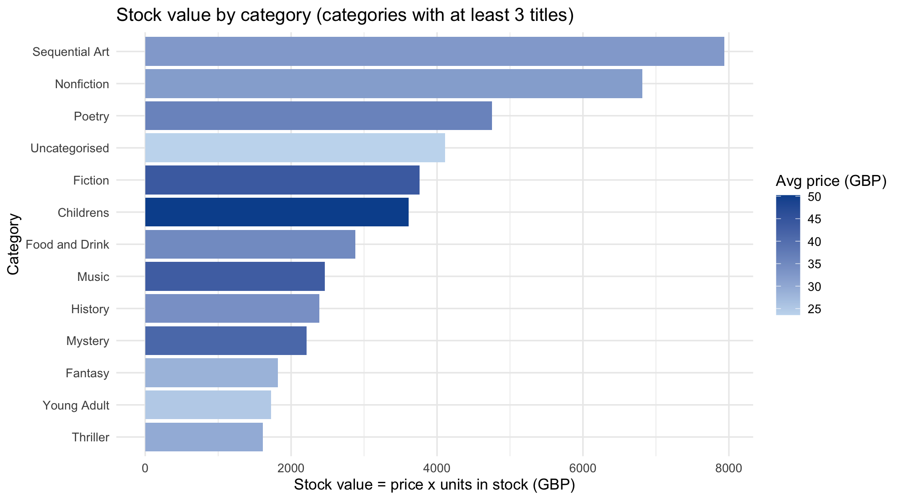

**Interpretation.** Sequential Art (graphic novels) and Nonfiction hold about 32% of the stock value. Their lead comes from the number of titles, not from price, since their averages (£32.42 and £31.82) are below Fiction (£43.87) and Childrens (£50.20). Childrens books are the most expensive group but the worst rated (2.0 stars), which looks like a pricing weakness. Fiction combines a high price with the best rating (3.8), so it is the competitor's strongest category. The "Uncategorised" group, which exists only because of missing source data, still ranks fourth with almost 9% of stock value. Poor category data would hide that share of the catalogue from category reports, which is why the imputation flags matter.

## 4.4 GitHub repository

The private repository **https://github.com/HappyDevs1/map-reduce-web-scraper** contains:

* **Documentation:** the root `README.md` (structure and how to run everything), a README per question folder, and this report (`docs/ITBDA4-14_Project2_Report.docx`, built from `docs/report_template.md` by `docs/build_report.py`).
* **Datasets:** `data/raw/` (the two zips from the brief, the Wikipedia snapshot, the cached book pages and the raw scraped CSV), `data/extracted/` (unzipped documents) and `data/processed/` (cleaned outputs of Questions 2, 3 and 4).
* **Notebooks:** one R Markdown notebook per R question with its rendered HTML, showing the flow from raw data to results. For Question 1 the Java project, run scripts and `evidence/` folder (logs, results and screenshots) play the same role.
* **History:** the work was committed in small steps, so the commit log shows how the project was built.
