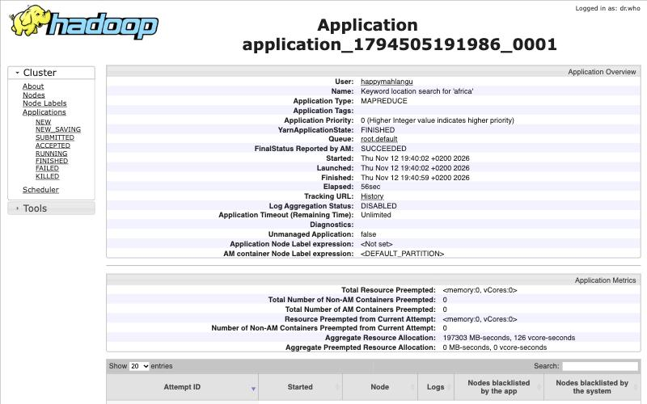
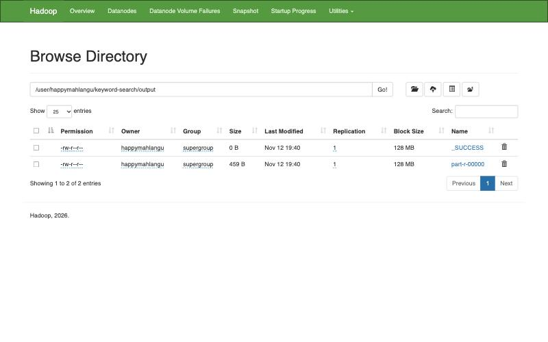

```{r setup, include=FALSE}
knitr::opts_chunk$set(echo = TRUE, message = FALSE, warning = FALSE)
library(dplyr)
library(stringr)
library(readr)
library(purrr)
```

This notebook shows the flow of the Question 1 job from the raw corpus to the final result. The MapReduce program itself is the Java project in this folder. The notebook builds it, runs it on the corpus with the keyword given in `params$keyword`, reads the output and checks it with an independent search in R. The keyword is a parameter, so a different one can be used with `rmarkdown::render("q1_mapreduce_keyword_search.Rmd", params = list(keyword = "government"))`.

Project repository: https://github.com/HappyDevs1/big-data-text-mining-etl

## 1. The corpus

```{r corpus}
docs_dir <- "../data/extracted/map_reduce_test_docs"
files <- list.files(docs_dir, pattern = "\\.txt$", full.names = TRUE)

corpus <- tibble(document = basename(files),
                 lines = map(files, read_lines)) |>
  mutate(n_lines = map_int(lines, length),
         n_chars = map_int(lines, ~ sum(nchar(.x))))

corpus |> select(document, n_lines, n_chars)
```

The corpus has `r nrow(corpus)` documents and `r sum(corpus$n_lines)` lines. Each document becomes one input split, so each one gets its own mapper.

## 2. Build the Java project

```{bash build}
mvn -q -B package -DskipTests
ls -l target/keyword-search.jar
```

## 3. Run the MapReduce job

The job runs in Hadoop local mode here so the notebook does not depend on running daemons. The same jar was also run on HDFS and YARN with `run_cluster.sh` (section 5). The keyword is passed in at run time as the third argument.

```{r run}
out_dir <- "output/notebook"
unlink(out_dir, recursive = TRUE)
log <- system2("hadoop",
               c("jar", "target/keyword-search.jar",
                 "-D", "fs.defaultFS=file:///",
                 "-D", "mapreduce.framework.name=local",
                 docs_dir, out_dir, params$keyword),
               stdout = TRUE, stderr = TRUE)

# Job status and the final job counters (the log also has per task counters before this point)
done <- which(str_detect(log, "completed successfully"))
job_summary <- log[done:length(log)]
job_summary[str_detect(job_summary, "completed successfully|LINES_SCANNED|KEYWORD_MATCHES|DOCUMENTS_WITH_MATCH|Map input records|Reduce input groups|Reduce output records")] |>
  str_squish()
```

## 4. Read the result

```{r result}
raw_output <- read_lines(file.path(out_dir, "part-r-00000"))
cat(raw_output, sep = "\n")

result <- tibble(line = raw_output) |>
  mutate(document  = str_extract(line, "^[^\t]+"),
         matches   = as.integer(str_extract(line, "(?<=matches=)\\d+")),
         locations = str_extract(line, "(?<=locations=).*$")) |>
  select(document, matches, locations)

result
```

The keyword "`r params$keyword`" occurs `r sum(result$matches)` times in `r sum(result$matches > 0)` of the `r nrow(result)` documents. Every location is a 1 based (row, column) pair, and documents without the keyword are still listed as "not found".

### Independent check in R

The same search (case insensitive, whole word) is done with a plain R regex over every line. The counts must match the MapReduce output.

```{r check}
pattern <- regex(paste0("(?<![\\p{L}\\p{N}])", params$keyword, "(?![\\p{L}\\p{N}])"),
                 ignore_case = TRUE)

r_scan <- corpus |>
  mutate(r_matches = map_int(lines, ~ sum(str_count(.x, pattern)))) |>
  select(document, r_matches)

check <- result |> inner_join(r_scan, by = "document") |>
  mutate(same = matches == r_matches)
check |> select(document, matches, r_matches, same)
stopifnot(all(check$same))
```

All `r nrow(check)` documents agree, so the MapReduce job finds every occurrence.

## 5. Evidence from the HDFS and YARN run

The cluster run used the same jar on a single node HDFS and YARN setup with the configuration in `hadoop-config/`. Its full log is in `evidence/run_cluster.log`.

```{r cluster}
cluster_log <- read_lines("evidence/run_cluster.log")
cluster_log[str_detect(cluster_log, "Submitted application|completed successfully|KEYWORD_MATCHES|DOCUMENTS_WITH_MATCH|LINES_SCANNED")] |>
  str_squish()

identical(read_lines("evidence/result_cluster_africa.txt"),
          read_lines("evidence/result_local_africa.txt"))
```

The cluster result is identical to the local result.




